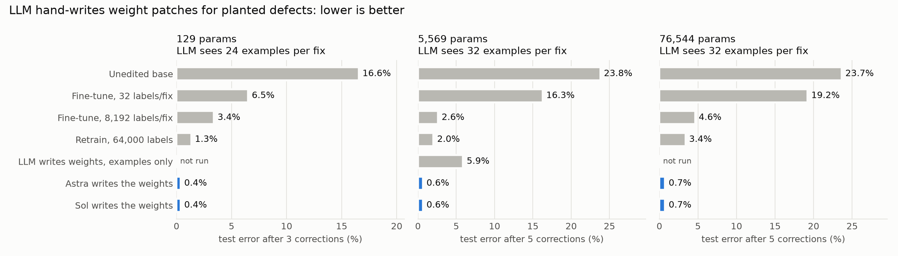

# weight-edit-lab

**Question.** Can a frontier LLM patch a trained neural net by writing its weights
by hand (no gradients), one correction after another, without breaking earlier
fixes? And does that hold as the net grows?

**Answer (2026-11-03/04 runs).** Yes, when each correction is given as one sentence.
In all 30 text-guided chains on the 5.6k- and 76.5k-param nets, the edited net
agrees with the ideal edit of its base net on **50,000 / 50,000** held-out inputs
(`fidelity.py`). Without the sentence (examples only), both models infer plausible
wrong rules and land at 88-94%.



## Setup
- Task: escalate an ops alert or not. A ReLU MLP is trained on a rule with planted
  defects. Corrections 1..K, applied in order, remove one defect each. Ground truth:
  [tasks.py](tasks.py).
- Sizes: `small` 6-16-1 (129 params, 3 corrections); `large` 20-64-64-1 (5,569
  params, 5 corrections); `xl` 40-256-256-1 (76,544 params, same 5 corrections,
  25 pure-noise inputs).
- Large/XL corrections: ignore tone; EU impact +0.15; critical tier with error rate
  above 0.7 always escalates; urgency doubles when confidence is below 0.4;
  maintenance window suppresses unless users_affected is above 0.5 (overrides the
  critical rule).
- Per correction, the editor gets: the sentence, 32 labelled examples (16 that
  change, 16 near misses), the current weights, numpy for forward passes. No
  gradient methods or solvers. Workspaces sit outside this folder; every log is
  scanned for reads of ground truth (none found).
- Editors: Codex `gpt-6-astra` and `gpt-6.1-sol`, reasoning effort high.
- 3 base seeds per size. Small: 2 repeats per model per seed (12 chains).
  Large: 3 repeats (18). XL: 2 repeats (12). Examples-only: large, 1 repeat (6).
- Baselines get every advantage: grid over lr, steps, replay ratio and cumulative
  labels, best picked by **hidden-test** accuracy, re-tuned for each label count.

## Results (final step, mean over chains; `analyze.py`, `fidelity.py`)

| | small (129) | large (5,569) | xl (76,544) |
|---|---|---|---|
| Unedited base | 83.4% | 76.2% | 76.4% |
| Fine-tune, 32 labels/fix | 93.5% | 83.7% | 80.8% |
| Fine-tune, 8,192 labels/fix | 96.6% | 97.4% | 95.4% |
| Retrain from scratch, 64,000 labels | 98.7% | 98.0% | 96.6% |
| **Astra writes weights** (24-32 ex/fix) | **99.6%** (6/6) | **99.4%** (9/9) | **99.3%** (6/6) |
| **Sol writes weights** | **99.6%** (6/6) | **99.4%** (9/9) | **99.3%** (6/6) |
| Fidelity to ideal edit | - | 100% (18/18) | 100% (12/12) |
| Examples only, no sentence | - | 92.1% (88-94%, 0/6) | - |

- Earlier fixes kept after the last step: 98.5% (large), 98.4% (xl), 99.9% (small).
  The shortfall from 100% is the base net's own error, not the edits: fidelity is
  exact.
- Every run on the same base seed scores identically to 4 decimals across models
  and repeats. Run-to-run luck plays no part once the edit is exact.
- XL seed 1 misses the strict 95% bar at step 2 (fix 93.8%) in all 4 chains. The
  edit is exact (impact + 0.15·EU in layer 1); the base net extrapolates badly to
  impact above 1, which it never saw in training.
- Cost: about 70-90 s and 20k-90k tokens per step. Nets grow by 1-3% (added gate units).

## How the models do it
Both models converge on the same toolkit (see `runs/*/seed*/*/step*/NOTES.md`):
- zero an input column (ignore tone);
- shift first-layer weights to re-interpret a feature: `W[region_eu] += 0.15 · W[impact]`;
- wrap the logit in exact ReLU gates: `max(f, g)` for overrides, `min(f, g)` for suppression;
- for "urgency doubles when confidence < 0.4", prepend 3 ReLU layers:
  `d = ReLU(0.4 − c)`, `r = ReLU(u − 2^54·d)`, `u' = 2u − r`. The 2^54 gain is an exact
  switch at float64 resolution. Astra notes that no finite ReLU net can make the
  switch exact over the reals and bounds the error.

## Examples only (no correction sentence)
Same chains, but the sentence is replaced by "infer the change from the examples".
Step 1 (ignore tone) and steps 3 and 5 (sharp overrides) are inferred exactly. Step 2 and step 4
are not: from 32 examples both models choose the same simplest-looking wrong
rule (an EU output offset; a box in urgency × confidence). Wrong guesses are never
corrected later. Final accuracy 88.1-94.3% (mean 92.1%), fidelity 88-94% (mean 92.2%).

## Examples plus asked labels (2026-11-04)
Same as examples-only, but each step has two phases. Phase 1: the model writes 2-4
candidate rules that fit all examples, then picks up to Q inputs whose labels
would tell them apart. The harness labels them from ground truth. Phase 2: the
model edits. Large task, 3 seeds × Astra and Sol (`mode=query1`, `query8`).

| Mode (large, 5,569 params) | Final acc. Astra | Final acc. Sol | Step-2 fix (mean / worst) | Step-4 fix (mean) |
|---|---|---|---|---|
| Sentence | 99.4% | 99.4% | 95.7% / 95.3% | 98.0% |
| Examples only | 93.1% | 91.1% | 95.3% / 78.2% | 79.2% |
| + 1 asked label per fix | 93.3% | 90.6% | 94.7% / 76.9% | 76.9% |
| + 8 asked labels per fix | 94.6% | 93.6% | 97.2% / 95.3% | 73.7% |

- One asked label changes nothing. Eight help a little: the step-2 failure
  (Sol, seed 2: fix 78%) disappears, and final accuracy rises 1.5-2.5 points.
- Step 4 does not improve at any budget. Every candidate rule the models write
  is a threshold box on raw features. The true rule ("read urgency as doubled,
  then let the network decide") is never among the candidates, so no label can
  select it. Questions tune a rule within the kind the model proposes; they do
  not fix a missing kind.
- 3 chains per cell: the 8-label gain has the same sign for both models but is
  small next to the gap to the sentence (5-6 points).

### Wider candidate lists (2026-11-04)
Phase 1 now requires candidates from at least 3 of 4 named kinds of rule (output
shift, region override, input re-interpretation, interaction). Caveat: the list
names the true kind for steps 2 and 4. Modes `query0w` (no labels) and `query8w`.

| Mode (large) | Astra | Sol | Mean (min-max) | Runs >= 99% | Step-4 fix mean (max) |
|---|---|---|---|---|---|
| Sentence | 99.4% | 99.4% | 99.4% | 18/18 | 98.0% |
| Examples only | 93.1% | 91.1% | 92.1% (88.1-94.3) | 0/6 | 79.2% (92.8) |
| + 8 asked labels | 94.6% | 93.6% | 94.1% (92.5-95.4) | 0/6 | 73.7% (76.8) |
| Wide list, no labels | 98.0% | 90.1% | 94.1% (79.0-99.1) | 2/6 | 91.5% (99.1) |
| Wide list + 8 asked labels | 96.8% | 95.1% | **96.0%** (92.7-98.3) | 0/6 | 77.9% (86.1) |

- A wider list lets the models find the true rule: Astra wrote "when confidence
  < 0.4, evaluate the existing model with urgency doubled" from examples alone and
  reached 99.0-99.1% on 2 of 3 seeds.
- It also lets in false rules: Sol chose "suppress when error_rate <= confidence",
  which fits all 32 examples, and fell to 79.0%.
- Adding 8 asked labels gives the best mean and the best worst case, but no run
  reaches 99%. In each step-4 run checked, the exact true rule was not among that
  run's written candidates (e.g. "set impact and urgency to 1 inside a region"),
  so the answers rejected every candidate and the model fell back to a box rule.
- Mostly ruled out: misleading answers. At step 4, 2 of 48 asked labels in the
  wide arm (both in Astra seed 0) and 0 of 48 in the narrow arm contradict the
  ideal edit of the base net, i.e. the base net itself is wrong at that probe.
  Over all query runs and steps, 13 of 480 asked labels (2.7%) contradict it,
  against 0.8% on random inputs at step 4.
- Whether the exact rule shows up among the drafts varies from run to run. With
  3 chains per cell, the gap between "wide, no labels" and "wide + labels" is
  within that variation.

## Real decision model: Laya (2026-11-04, interim)
Laya (convaiinnovations/laya, Apache 2.0) routes Banking77 customer messages to 5
departments. Its zero-shot accuracy is 70.3%. The encoder and head layers stay frozen;
editors may change only the scorer MLP (about 1.05M params) or add a ReLU module, using
one sentence + 32 messages per correction and a tool that embeds messages they write.
The 3 corrections target Laya's real error clusters (exchange-rate complaints, PIN
issues, eligibility questions; 80 test messages each). Code: `laya/`. Prior work and
framing: [PRIOR_WORK.md](PRIOR_WORK.md).

| Method (2 seeds each, `laya/laya_analyze.py`) | Final acc. | Target fixed | Drift elsewhere | Min/chain |
|---|---|---|---|---|
| Unedited Laya | 70.3% | - | - | - |
| Opus 5.5 writes weights | 76.9% | 81% | 7.1% | 45 |
| Opus 5.5 code patch (Python override) | 77.1% | 77% | 1.8% | 5 |
| Astra code patch | 76.2% | 62% | 1.4% | 5 |
| Astra writes weights | 67.9% | 76% | 23% | 71 |
| Sol writes weights | 67.5% | 89% | 26% | 84 |

- Reasoning effort was not matched: Astra and Sol ran at `high`; Opus ran with no
  `--effort` flag (the Claude Code default, reported as medium). A rerun of Opus at
  `high` is in progress.
- Columns: "Target fixed" = share of the 80 test messages of the latest correction's
  intents routed correctly after the last step. "Drift elsewhere" = share of test
  messages outside all corrected intents whose department changed vs unedited Laya.
- Opus finds concept directions from hundreds of messages it writes itself and adds
  narrow single-unit switches; it ties the code patch. Astra and Sol fix the targets
  but move a quarter of all other messages.
- Gradient fine-tuning of the scorer on the same messages: rerun with a wider grid in
  progress (the first grid's best point sat at its edge).
- Unlike the synthetic tasks, edits here are approximate: drift is the main cost.

## What is not in this repo
Python environment, the Laya checkpoint (download from Hugging Face), Banking77
(PolyAI/banking77), cached marker vectors, saved weight files (`*.npz`, `*.npy`),
`model_in.json` (equal to the previous step's output), and the 76k-param XL network
files. Local paths in logs are replaced by `<lab>`, `$WSROOT` and `~`.

## Limits
- Every correction is a crisp rule. A code override (preprocess the input, post-
  process the output) would score the same. The value shown is that the patch
  stays a single standard neural net, written exactly. It is not shown that weight
  editing beats code.
- Synthetic task, one rule family, MLPs only.
- The information is in the sentence. Examples alone under-determine the rule.

## Reproduce
```
python3 -m venv .venv && .venv/bin/pip install numpy matplotlib
.venv/bin/python harness.py base large 0 1 2
.venv/bin/python harness.py smoke large 0          # must print SMOKE OK
WSROOT=/some/dir/outside/this/repo .venv/bin/python harness.py edits large 0,1,2 3 astra,sol 6
.venv/bin/python harness.py baselines large 0 1 2
.venv/bin/python analyze.py && .venv/bin/python fidelity.py && .venv/bin/python plot.py
```
`make_base.py`, `baselines.py` and `edit_llm.py` (results in `runs/base`,
`runs/astra`, `runs/sol`) are the first single-run version, kept for the record.
