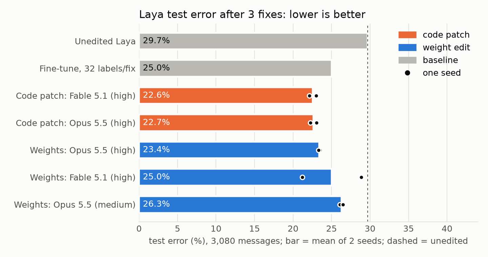

# weight-edit-lab

**Question.** Can a frontier LLM patch a trained neural net by writing its weights
by hand (no gradients), one correction after another, without breaking earlier
fixes? And does that hold as the net grows?

**Answer.** On toy nets, yes, when each correction is given as one sentence.
In all 30 text-guided chains on the 5.6k- and 76.5k-param nets, the edited net
agrees with the ideal edit of its base net on **50,000 / 50,000** held-out inputs
(`fidelity.py`). Without the sentence (examples only), both models infer plausible
wrong rules and land at 91-99% (mean 94.1%). On a real decision model (Laya, 421M), in a
two-seed pilot, code patches had the lowest mean error: 22.6-22.7% test error, against
23.4-26.3% for weight edits (mean per model) and 25.0% for fine-tuning, from 29.7%
unedited. Single weight-edit runs vary a lot: the best one (21.2%) beat every code patch.




## Setup
- Task: escalate an ops alert or not. A ReLU MLP is trained on a rule with planted
  defects. Corrections 1..K, applied in order, remove one defect each. Ground truth:
  [tasks.py](tasks.py).
- Sizes: `small` 6-16-1 (129 params, 3 corrections); `large` 20-64-64-1 (5,569
  params, 5 corrections); `xl` 40-256-256-1 (76,545 params, same 5 corrections,
  25 pure-noise inputs).
- Large/XL corrections: ignore tone; EU impact +0.15; critical tier with error rate
  above 0.7 always escalates; urgency doubles when confidence is below 0.4;
  maintenance window suppresses unless users_affected is above 0.5 (overrides the
  critical rule).
- Per correction, the editor gets: the sentence, 32 labelled examples (16 that
  change, 16 near misses), the current weights, numpy for forward passes. No
  gradient methods or solvers. Workspaces sit outside this folder; every log is
  scanned for reads of ground truth (none found). The examples-only and query arms
  and the Laya rerun ran inside an enforced macOS sandbox (`sandbox.py`) that denies
  reads of ground truth, test data, earlier runs and review files. The sentence arms
  ran before it existed and rely on the log scan.
- Editors: Codex `gpt-6-astra` and `gpt-6.1-sol`, reasoning effort high.
- 3 base seeds per size. Small: 2 repeats per model per seed (12 chains).
  Large: 3 repeats (18). XL: 2 repeats (12). Examples-only: large, 1 repeat (6).
- Baselines get every advantage: grid over lr, steps, replay ratio and cumulative
  labels, best picked by **hidden-test** accuracy, re-tuned for each label count.

## Results (final step, mean over chains; `analyze.py`, `fidelity.py`)

| | small (129) | large (5,569) | xl (76,545) |
|---|---|---|---|
| Unedited base | 83.4% | 76.2% | 76.4% |
| Fine-tune, 32 labels/fix | 93.5% | 83.7% | 80.8% |
| Fine-tune, 8,192 labels/fix | 96.6% | 97.4% | 95.4% |
| Retrain from scratch, 64,000 labels | 98.7% | 98.0% | 96.6% |
| **Astra writes weights** (24-32 ex/fix) | **99.6%** (6/6) | **99.4%** (9/9) | **99.3%** (4/6 strict) |
| **Sol writes weights** | **99.6%** (6/6) | **99.4%** (9/9) | **99.3%** (4/6 strict) |
| Agreement with ideal edit on 50,000 sampled inputs | - | 100% (18/18) | 100% (12/12) |
| Examples only, no sentence | - | 94.1% (90.9-98.8%, 0/6) | - |

- Earlier fixes kept after the last step: 98.5% (large), 98.4% (xl), 99.9% (small).
  On the sampled test set, the shortfall from 100% matches the base net's own error:
  the edited net agrees with the ideal edit of its base on all 50,000 inputs. This is
  sampled agreement in float64, not a proof over all inputs; near a decision boundary,
  floating-point sign can still differ.
- Every run on the same base seed scores identically to 4 decimals across models
  and repeats.
- XL seed 1 misses the strict 95% bar at step 2 (fix 93.8%) in all 4 chains, so 4 of
  6 XL chains per editor pass the strict bar. The edit is the intended one
  (impact + 0.15·EU in layer 1); the base net extrapolates badly to impact above 1,
  which it never saw in training.
- Cost: about 70-90 s and 20k-90k tokens per step.
- Editors may add units and layers; baselines keep the original architecture. Stored
  parameters grow +75-609% (small), +43-54% (large), +10-16% (XL); non-zero entries
  grow +9-47%, +0.5-2.2% and -0.1-0.3%.

## How the models do it
Both models converge on the same toolkit (see `runs/*/seed*/*/step*/NOTES.md`):
- zero an input column (ignore tone);
- shift first-layer weights to re-interpret a feature: `W[region_eu] += 0.15 · W[impact]`;
- wrap the logit in exact ReLU gates: `max(f, g)` for overrides, `min(f, g)` for suppression;
- for "urgency doubles when confidence < 0.4", prepend 3 ReLU layers:
  `d = ReLU(0.4 − c)`, `r = ReLU(u − 2^54·d)`, `u' = 2u − r`. The 2^54 gain is an exact
  switch at float64 resolution. Astra notes that no finite ReLU net can make the
  switch exact over the reals and bounds the error.

## Examples only, and examples plus asked labels
Same chains on the large task, but the sentence is replaced by "infer the change from
the examples". In the query modes each step has two phases. Phase 1: the model writes
2-4 candidate rules that fit all examples, then picks up to Q inputs whose labels
would tell them apart; the harness labels them from ground truth. Phase 2: the model
edits. "Wide" modes require candidates from at least 3 of 4 named kinds of rule
(output shift, region override, input re-interpretation, interaction); that list
names the true kind for steps 2 and 4. 3 seeds x Astra and Sol per mode, 6 chains.

Numbers below are from the sandboxed rerun (tag `-r2`, full-precision evidence;
`ROUND=2 python analyze.py`). Round-1 numbers are in `results/analyze_round1.txt`.

| Mode (large, 5,569 params) | Astra | Sol | Mean (min-max) | Runs >= 99% | Step-2 fix mean / worst | Step-4 fix mean (max) |
|---|---|---|---|---|---|---|
| Sentence | 99.4% | 99.4% | 99.4% | 18/18 | 95.7% / 95.3% | 98.0% |
| Examples only | 94.2% | 94.0% | 94.1% (90.9-98.8) | 0/6 | 98.5% / 97.8% | 78.6% (97.6) |
| + 1 asked label per fix | 94.7% | 91.4% | 93.0% (86.6-97.8) | 0/6 | 94.6% / 80.8% | 80.8% (96.0) |
| + 8 asked labels per fix | 92.3% | 93.2% | 92.7% (88.1-94.4) | 0/6 | 94.8% / 78.3% | 74.9% (77.6) |
| Wide list, no labels | 95.5% | 88.7% | 92.1% (72.4-98.7) | 0/6 | 95.4% / 80.1% | 87.0% (100.0) |
| Wide list + 8 asked labels | 97.3% | 98.0% | **97.6%** (96.1-99.0) | 1/6 | 96.1% / 91.9% | 91.8% (99.9) |

- Step 4 ("urgency doubles when confidence is below 0.4") is the hard step. Without
  the sentence it fails the 95% bar in almost every chain; later steps inherit the error.
- Asked labels alone do not help: 1 or 8 labels per fix score no better than examples
  only. The wide list alone does not help on average either, and it lets in false
  rules (worst run 72.4%).
- Wide list + 8 asked labels is the best mode in both rounds (rerun 97.6%, round 1
  96.0%), with the best worst case. Only one run of 30 without the sentence reaches 99%.
- 3 chains per model and mode: differences of 1-2 points between the other modes are
  within run-to-run variation. Round 1 suggested a small gain from 8 labels and an
  exact rule found by the wide list alone in 2 of 6 runs; the rerun shows neither.

Protocol note: in these arms each step also re-supplies all earlier evidence and
earlier answered queries, with their original labels. That is extra supervision beyond
the 32 new examples (128 labels at step 4, 160 at step 5, plus queries), so "1 label"
means one new chosen query per step. Round 1 wrote evidence with 3 decimals after
labelling (a few boundary rows carried the wrong label) and relabelled earlier evidence
with the current target; the rerun fixes both.

## Real decision model: Laya
Laya (convaiinnovations/laya, Apache 2.0) routes Banking77 customer messages to 5
departments. Its zero-shot accuracy is 70.3%. The encoder and head layers stay frozen;
editors may change only the scorer MLP (about 1.05M params) or add a ReLU module, using
one sentence + 32 messages per correction and a tool that embeds messages they write.
The 3 corrections target 3 of Laya's largest error clusters (exchange-rate complaints,
PIN issues, eligibility questions; 80 test messages each). Code: `laya/`. Prior work
and framing: [PRIOR_WORK.md](PRIOR_WORK.md).

Rerun (sandboxed, full tool transcripts; `ROUND=2 python laya/laya_analyze.py`):

| Method (2 seeds each) | Effort | Final acc. (seed 0, seed 1) | Acc. on correction intents | Drift elsewhere | Min/chain |
|---|---|---|---|---|---|
| Unedited Laya | - | 70.3% | 12.5% | - | - |
| Fable 5.1 code patch (Python override) | high | **77.4%** (77.9, 77.0) | 89.8% | 2.0% | 9 |
| Opus 5.5 code patch | high | 77.3% (77.7, 76.9) | 87.9% | 2.1% | 5 |
| Opus 5.5 writes weights | high | 76.6% (76.5, 76.7) | 80.6% | 3.6% | 112 |
| Fable 5.1 writes weights | high | 75.0% (71.1, **78.8**) | 82.9% | 12.0% | 90 |
| Fine-tune scorer, 32 labels/fix (best of 32 configs per seed, picked on test) | - | 75.0% | 49.2% | 19.0% | - |
| Opus 5.5 writes weights | medium | 73.7% (73.9, 73.5) | 65.0% | 10.0% | 70 |

Round 1 (same protocol, no enforced sandbox; `ROUND=1`), including methods not rerun:

| Method | Effort | Final acc. | Acc. on correction intents | Drift elsewhere |
|---|---|---|---|---|
| Opus 5.5 code patch | high | 78.1% | 90.8% | 3.1% |
| Fable 5.1 code patch | high | 77.7% | 91.3% | 2.8% |
| Opus 5.5 code patch | medium | 77.1% | 84.8% | 1.8% |
| Opus 5.5 writes weights | medium | 76.9% | 86.7% | 7.1% |
| Astra code patch | high | 76.2% | 77.1% | 1.4% |
| Fable 5.1 writes weights | high | 74.8% | 71.9% | 7.4% |
| Opus 5.5 writes weights | high | 72.9% | 46.0% | 2.3% |
| Astra writes weights | high | 67.9% | 78.8% | 23% |
| Sol writes weights | high | 67.5% | 84.8% | 26% |

- **Verdict: in both rounds, code patches had the highest mean accuracy** (rerun
  77.3-77.4%, round 1 77.1-78.1%). The best weight-edit mean is 0.8-1.2 points lower,
  at 6-22x the time. Fine-tuning plateaus at 75-76% even with 256 labels per correction.
- Weight edits vary much more than code patches. Fable-high scored 71.1% and 78.8% on
  the two seeds; the 78.8% run is the best single run of any method in the rerun. The
  weak seed also drifted most: it changed 17.7% of untouched messages, against 6.2%.
- The same arm moves between rounds by as much as effort does: Opus-high weight edits
  went from 72.9% (round 1, one refusal) to 76.6%, Opus-medium from 76.9% to 73.7%. With
  2 seeds, no claim about effort for weight edits holds.
- Round 1, Opus at high refused to edit on seed 0: it concluded the scorer cannot tell
  which department it is scoring and shipped the weights unchanged.
- Weight edits that work find concept directions from hundreds of messages the editor
  writes itself and add narrow single-unit switches. Astra and Sol (round 1) fix the
  targets but move about a quarter of all other messages.
- Unlike the synthetic tasks, edits here are approximate: drift is the main cost.
- Columns: "Acc. on correction intents" = share of the 240 test messages covered by any of
  the 3 corrections that are routed correctly after the last step. "Drift elsewhere" =
  share of test messages outside all corrected intents whose department changed vs
  unedited Laya. Fine-tune drift and accuracy: `laya/laya_baselines.py`.
- Isolation. Rerun: test data, labels and the intent truth live outside the lab, and a
  macOS sandbox denies editors reads of them, of `laya/runs` and of the corrections file.
  Claude editors log full tool transcripts; `laya/audit_transcripts.py` found 0 attempts
  to read hidden data in 30 steps (one `ls` of the lab folder touched `runs/` and was
  denied). Round 1: the same files sat inside the lab, Codex log scans found no reads,
  and Claude logs held only the final answer, so leakage there is not ruled out.
- Baseline numbers (here and above) are oracle-selected on the test set, which favours
  the baselines. Budgets are matched in labels only: editors also get the rule text,
  can embed hundreds of self-written messages, and can add architecture.
- "Exact on named features, approximate on embeddings" is an observed contrast across
  two very different set-ups, not an isolated cause.

## What is not in this repo
Python environment, the Laya checkpoint (download from Hugging Face), Banking77
(PolyAI/banking77), cached marker vectors, saved weight files (`*.npz`, `*.npy`),
`model_in.json` (equal to the previous step's output), and the 76k-param XL network
files. Local paths in logs are replaced by `<lab>`, `$WSROOT` and `~`.

## Limits
- Every correction is a crisp rule. A code override (preprocess the input, post-
  process the output) would score the same. The value shown is that the patch
  stays a single standard neural net, written exactly. It is not shown that weight
  editing beats code.
- Synthetic task, one rule family, MLPs only. Laya: one task, 2 seeds per method.
- The information is in the sentence. Examples alone under-determine the rule.

## Reproduce
```
python3 -m venv .venv && .venv/bin/pip install numpy matplotlib
.venv/bin/python harness.py base large 0 1 2
.venv/bin/python harness.py smoke large 0          # must print SMOKE OK
WSROOT=/some/dir/outside/this/repo .venv/bin/python harness.py edits large 0,1,2 3 astra,sol 6
.venv/bin/python harness.py baselines large 0 1 2
ROUND=2 .venv/bin/python analyze.py && .venv/bin/python fidelity.py && .venv/bin/python plot.py
```
Laya: put `laya/ground_truth/departments_truth.py` and PolyAI/banking77 (`data/`) in
`$WEIGHT_EDIT_HIDDEN` (default `~/.weight-edit-hidden/laya`), download
`convaiinnovations/laya` into `laya/hub`, then:
```
cd laya && pip install torch transformers safetensors pyarrow huggingface_hub
python laya_lab.py cache && python laya_lab.py base
python laya_harness.py smoke
WSROOT=/dir/outside/repo python laya_harness.py edits 0,1 opus-high,fable-high 2 text
python laya_baselines.py 0 1 && ROUND=2 python laya_analyze.py && python plot_laya.py
```
Saved Laya weight files are not in the repo; the per-step test predictions are
(`laya/runs/*/step*/test_pred.npy` are excluded too: rerun to regenerate).

`make_base.py`, `baselines.py` and `edit_llm.py` (results in `runs/base`,
`runs/astra`, `runs/sol`) are the first single-run version, kept for the record.
